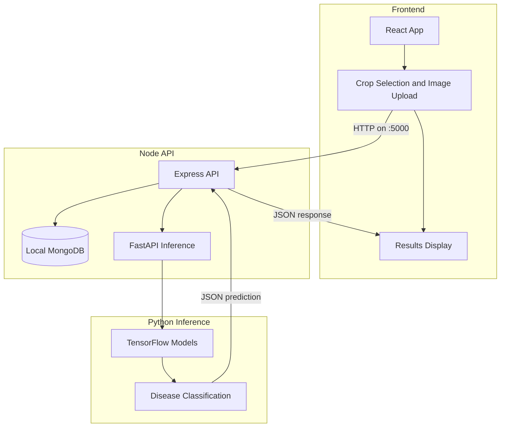

# 🌿 Plant Disease Detection (PDD) System

<div align="center">
  
  
  <h2>AI-Powered Plant Disease Detection System</h2>

  [](https://fastapi.tiangolo.com/)
  [](https://reactjs.org/)
  [](https://www.tensorflow.org/)
  [](https://www.python.org/)
  [](https://material-ui.com/)
  [](https://developer.mozilla.org/en-US/docs/Web/JavaScript)
  [](https://www.typescriptlang.org/)

  <p align="center">
    <a href="#-key-features">Key Features</a> •
    <a href="#-system-architecture">Architecture</a> •
    <a href="#-quick-start">Quick Start</a> •
    <a href="#-supported-plants">Plants</a> •
    <a href="#-tech-stack">Tech Stack</a> •
    <a href="#-api-reference">API</a>
  </p>
</div>

## 🌟 Key Features

<div align="center">
  <table>
    <tr>
      <td align="center">
        <br/>
        <b>AI-Powered Analysis</b><br/>
        <sub>Advanced ML models</sub>
      </td>
      <td align="center">
        <br/>
        <b>Real-time Detection</b><br/>
        <sub>Instant results</sub>
      </td>
      <td align="center">
        <br/>
        <b>Cross-platform</b><br/>
        <sub>Works everywhere</sub>
      </td>
      <td align="center">
        <br/>
        <b>Fast Processing</b><br/>
        <sub>Optimized backend</sub>
      </td>
    </tr>
    <tr>
      <td align="center">
        <br/>
        <b>Easy Upload</b><br/>
        <sub>Drag & drop support</sub>
      </td>
      <td align="center">
        <br/>
        <b>Multi-plant Support</b><br/>
        <sub>4 plant types</sub>
      </td>
      <td align="center">
        <br/>
        <b>Efficient Storage</b><br/>
        <sub>Optimized data handling</sub>
      </td>
      <td align="center">
        <br/>
        <b>Secure System</b><br/>
        <sub>Protected endpoints</sub>
      </td>
    </tr>
  </table>
</div>

## 🏗 System Architecture

### High-Level Overview


## 🚀 Quick Start

### Prerequisites
<div align="center">
  <table>
    <tr>
      <td align="center">
        <br/>
        Python 3.11
      </td>
      <td align="center">
        <br/>
        Node.js ≥ 18
      </td>
      <td align="center">
        <br/>
        npm ≥ 6
      </td>
    </tr>
  </table>
</div>

### Backend Setup
```bash
# Start FastAPI inference service
cd backend
python3.11 -m venv .venv
source .venv/bin/activate
pip install -r requirements.txt
uvicorn main:app --reload --port 8000
```

### Express API
```bash
cd server
npm install
npm run dev
```

### React Frontend
```bash
cd frontend
npm install
NODE_OPTIONS=--openssl-legacy-provider npm start
```

## 🌿 Supported Plants

<div align="center">
  <table>
    <tr>
      <td align="center" width="200">
        <br/>
        <h3>🍅 Tomato</h3>
        <details>
          <summary>View Conditions</summary>
          • Bacterial spot<br/>
          • Early blight<br/>
          • Late blight<br/>
          • Leaf Mold<br/>
          • Septoria leaf spot<br/>
          • Spider mites<br/>
          • Yellow Leaf Curl Virus<br/>
          • Target Spot<br/>
          • Mosaic virus<br/>
          • Healthy
        </details>
      </td>
      <td align="center" width="200">
        <br/>
        <h3>🥔 Potato</h3>
        <details>
          <summary>View Conditions</summary>
          • Early blight<br/>
          • Late blight<br/>
          • Healthy
        </details>
      </td>
      <td align="center" width="200">
        <br/>
        <h3>🍇 Grape</h3>
        <details>
          <summary>View Conditions</summary>
          • Black rot<br/>
          • Esca (Black Measles)<br/>
          • Leaf blight<br/>
          • Healthy
        </details>
      </td>
      <td align="center" width="200">
        <br/>
        <h3>🌽 Corn</h3>
        <details>
          <summary>View Conditions</summary>
          • Cercospora leaf spot<br/>
          • Common rust<br/>
          • Northern Leaf Blight<br/>
          • Healthy
        </details>
      </td>
    </tr>
  </table>
</div>

## 💻 Tech Stack

### Frontend Technologies
<div align="center">
  
  
  
  
  
  
</div>

### Backend Technologies
<div align="center">
  
  
  
  
  
</div>

## 📡 API Reference

### Endpoints

| Method | Endpoint | Description |
|--------|----------|-------------|
| GET | `/ping` | Health check |
| POST | `/predict/{model_id}` | Disease prediction |

### Request Format
```json
{
  "file": "binary_image_data"
}
```

### Response Format
```json
{
  "class": "disease_name",
  "confidence": 0.95
}
```

## 🔧 Configuration

### Backend Environment Variables
```env
MODEL_PATH_PLANT_CLASSIFIER=path/to/classifier/model
TOMATO_MODEL=path/to/tomato/model
POTATO_MODEL=path/to/potato/model
GRAPE_MODEL=path/to/grape/model
CORN_MODEL=path/to/corn/model
```

### Frontend Environment Variables
```env
REACT_APP_API_URL=http://localhost:8000/predict
```

## 📱 Mobile Support

<div align="center">
  <table>
    <tr>
      <td align="center">
        <br/>
        Android
      </td>
      <td align="center">
        <br/>
        iOS
      </td>
      <td align="center">
        <br/>
        Windows
      </td>
    </tr>
  </table>
</div>

## 🤝 Contributing

Contributions are welcome! Please feel free to submit a Pull Request.

<div align="center">
  
</div>

## 📄 License

This project is licensed under the MIT License - see the [LICENSE](LICENSE) file for details.

## 🙏 Acknowledgments

<div align="center">
  <table>
    <tr>
      <td align="center">
        <br/>
        TensorFlow
      </td>
      <td align="center">
        <br/>
        FastAPI
      </td>
      <td align="center">
        <br/>
        React
      </td>
      <td align="center">
        <br/>
        Material-UI
      </td>
    </tr>
  </table>
</div>

---

<div align="center">
  
  <br/>
  <sub>© 2024 Plant Disease Detection Team. All rights reserved.</sub>
</div>


# AI-Driven Crop Disease Prediction Web App

A web application where a farmer or user photographs a crop leaf, uploads it, and gets an instant
diagnosis: the disease name, a confidence score, and practical treatment recommendations.

## Why this project
Crop diseases are often identified late through manual inspection, and agricultural experts are
scarce in many rural areas. This app makes fast, low-cost diagnosis available to anyone with a
phone camera and a browser.

## Features
- Leaf photo upload (gallery or camera) for Tomato, Potato, Grape and Corn
- CNN-based disease classification with confidence score
- Remedy recommendations: what to do now, organic and chemical options, prevention
- Prediction history, disease library, and printable reports
- Responsive, mobile-friendly UI

## How it works
Upload photo -> CNN (transfer learning) -> Disease + Confidence + Remedy

| Layer | Technology |
|---|---|
| Frontend | React |
| Inference service | Python, FastAPI, TensorFlow/Keras |
| Models | Per-crop CNNs trained on PlantVillage-style leaf images (.h5) |

## MERN architecture

The application uses React, Express, and a local MongoDB database for user accounts and saved scans. The existing Python/FastAPI/TensorFlow service remains the inference service; the browser never calls it directly.

```text
React (localhost:3000) -> Express API (127.0.0.1:5001) -> MongoDB (127.0.0.1:27017)
                                             |
                                             +-> FastAPI/TensorFlow (127.0.0.1:8000)
```

- React calls `http://127.0.0.1:5001/api`, including for health checks and image predictions. Port 5000 is reserved by a macOS service on this machine.
- Express stores bcrypt-hashed user credentials and authenticated scan history in the local `leaflens` MongoDB database.
- Express forwards image uploads to FastAPI. Guest predictions are not saved to MongoDB; guests retain the existing browser-local history. Sign in to save predictions to the account.
- Existing guest scan history can be imported into an account after login.
- The MongoDB URI is local only: `mongodb://127.0.0.1:27017/leaflens`. No cloud database or Docker is used.

### Local setup and start commands (macOS)

Start MongoDB (if it is not already running) and verify the local server:

```bash
brew services start mongodb-community
mongosh --quiet --eval 'db.runCommand({ ping: 1 })' 'mongodb://127.0.0.1:27017/admin'
```

Run each remaining service in a separate Terminal tab:

```bash
# 1. FastAPI inference service (Python 3.11; model paths are set in backend/.env)
cd backend
python3.11 -m venv .venv
source .venv/bin/activate
pip install -r requirements.txt
uvicorn main:app --reload --port 8000
```

```bash
# 2. Express API
cd server
npm install
npm run dev
```

```bash
# 3. React development server
cd frontend
npm install
NODE_OPTIONS=--openssl-legacy-provider npm start
```

Local server configuration is in the ignored `server/.env`; React reads `REACT_APP_API_BASE` from `frontend/.env`. FastAPI's model paths are configured in the ignored `backend/.env`.

### API smoke-test examples

Register and log in to get a JWT, then use it for the authenticated prediction:

```bash
curl -X POST http://127.0.0.1:5001/api/auth/register \
  -H 'Content-Type: application/json' \
  -d '{"name":"LeafLens User","email":"grower@example.com","password":"LocalPass123!"}'

curl -X POST http://127.0.0.1:5001/api/auth/login \
  -H 'Content-Type: application/json' \
  -d '{"email":"grower@example.com","password":"LocalPass123!"}'

curl http://127.0.0.1:5001/api/health

curl -X POST http://127.0.0.1:5001/api/predict/tomato \
  -H 'Authorization: Bearer YOUR_JWT_HERE' \
  -F 'file=@/absolute/path/to/your-leaf-photo.jpg'
```

Replace `YOUR_JWT_HERE` with the `token` returned by login and the image path with an actual leaf photo. The repository does not include a standalone sample leaf image. The health response reports Express, MongoDB, and FastAPI separately; prediction also requires the FastAPI model files to load successfully.

## Supported classes
21 classes across 4 crops: Tomato (10), Potato (3), Grape (4), Corn (4), each including a healthy class.

## Getting started

### Backend (Python 3.11; TensorFlow 2.16.2)
    cd backend
  python3.11 -m venv .venv
  source .venv/bin/activate
    pip install -r requirements.txt
  python -m uvicorn main:app --reload --port 8000

### Express API (port 5001)
  cd server
  npm install
  npm run dev

### Frontend (port 3000)
    cd frontend
    npm install
  NODE_OPTIONS=--openssl-legacy-provider npm start

If you are on Node 17 or later and `npm start` fails with `ERR_OSSL_EVP_UNSUPPORTED`, set
`NODE_OPTIONS=--openssl-legacy-provider` before starting.

## Deployment and Docker

This repository is already structured for the deployment targets requested by the project:

- Vercel for the React frontend (`frontend` app)
- Render for the Express API (`server` app)
- Render for the FastAPI inference service (repository root; model files are in the sibling `Models` directory)
- MongoDB Atlas for the production database
- Docker Compose for a local fallback stack with a local MongoDB container

### Cloud environment variables

Set these in each deployment target rather than relying on local machine-only values:

- Frontend (`Vercel`): `REACT_APP_API_BASE=https://your-express-api.onrender.com/api`
- Express (`Render`): `PORT=5001`, `HOST=0.0.0.0`, `MONGO_URI=mongodb+srv://<user>:<password>@<cluster>.mongodb.net/leaflens`, `JWT_SECRET=<32+ random chars>`, `JWT_EXPIRES_IN=7d`, `FASTAPI_URL=https://your-fastapi-service.onrender.com`, `CLIENT_ORIGIN=https://your-frontend.vercel.app`
- FastAPI (`Render`): `PORT` (provided by Render), `HOST=0.0.0.0`, `TOMATO_MODEL=Models/Tomato_Model/Model_T_v2.h5`, `POTATO_MODEL=Models/Potato_Model/Model_P_v5.h5`, `GRAPE_MODEL=Models/Grap_Model/Model_G_v2.h5`, `CORN_MODEL=Models/Corn_Model/Model_C_v4.h5`

Do not commit `.env` files or database credentials. Place secrets in the hosting provider's environment settings.

For the FastAPI service, configure the Render root directory as the repository root (leave it blank). Its build command is `pip install -r backend/requirements.txt` and its start command is `python -m uvicorn backend.main:app --host 0.0.0.0 --port $PORT`. Setting the root directory to `backend` would exclude the model files from the build context.

### Local Docker Compose

A root `docker-compose.yml` is included to run the app locally with a MongoDB container and the existing app services. Use the Docker Compose service names inside the network instead of `localhost` for container-to-container communication.

Example:

```bash
docker compose up --build
```

The frontend will be available on `http://localhost:3000`, the Express API on `http://localhost:5001`, the FastAPI service on `http://localhost:8000`, and MongoDB on `mongodb://localhost:27017` for local inspection.

## Limitations
Models are trained on controlled, PlantVillage-style images and can be less accurate on photos with
busy backgrounds. Results are AI-assisted guidance, not a substitute for an agricultural expert.
Always follow product labels and local agricultural advice before applying treatments.

## Roadmap
Multi-language and voice support, more crops, and offline inference.

## Credits and license
Built on [mohamedhaitham22/Plant-Diseases-Detection-using-CNN](https://github.com/mohamedhaitham22/Plant-Diseases-Detection-using-CNN)
(MIT). Released under the MIT License, see [LICENSE](LICENSE).